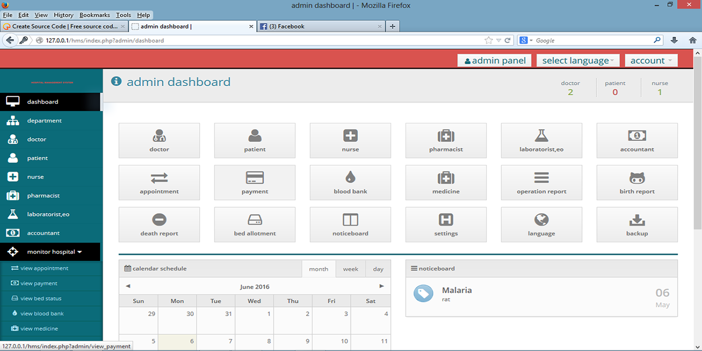
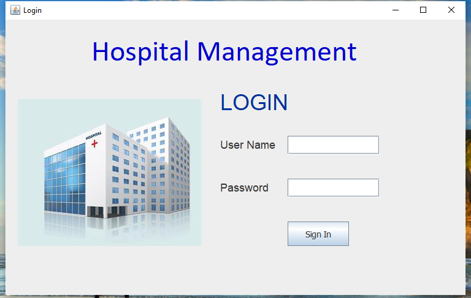
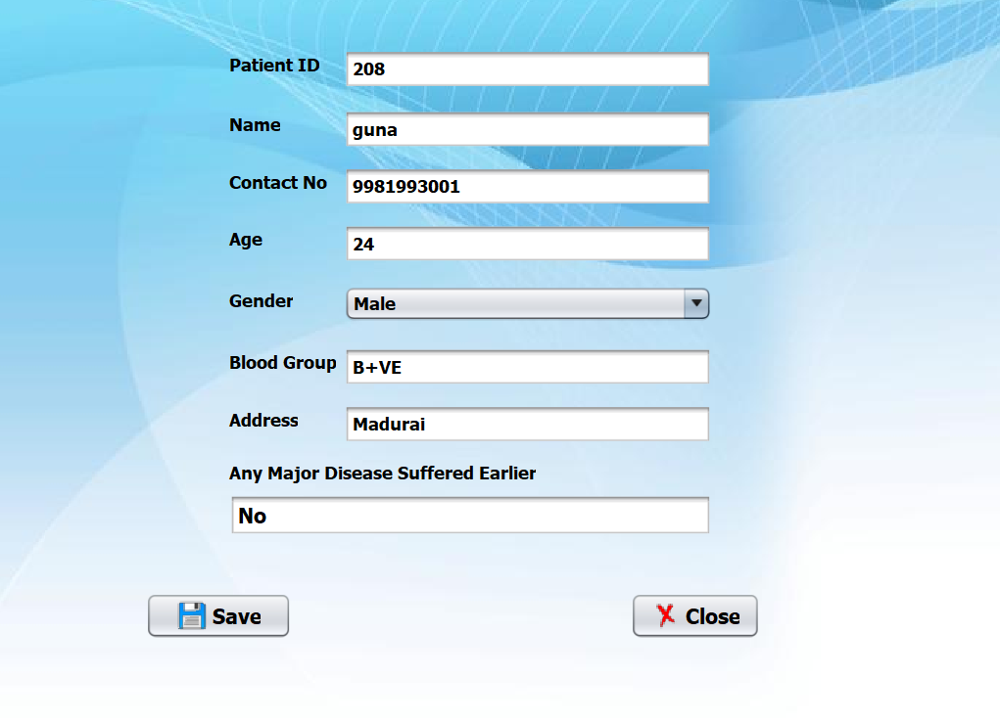
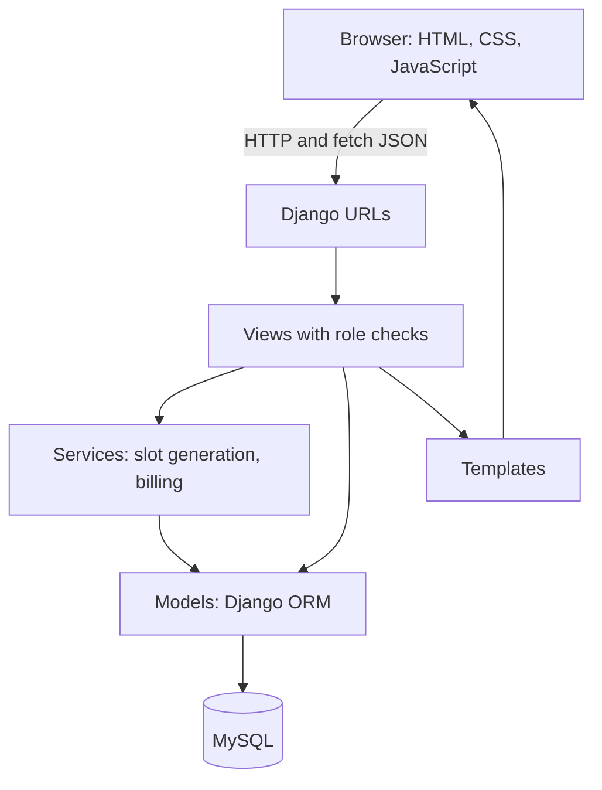
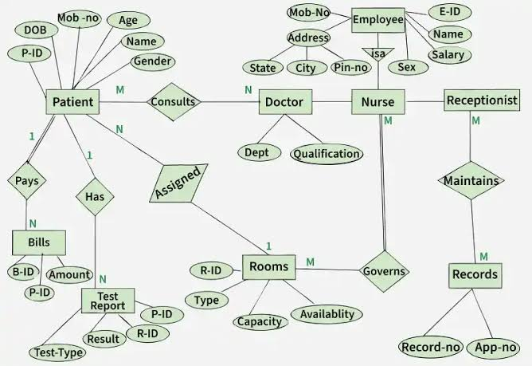
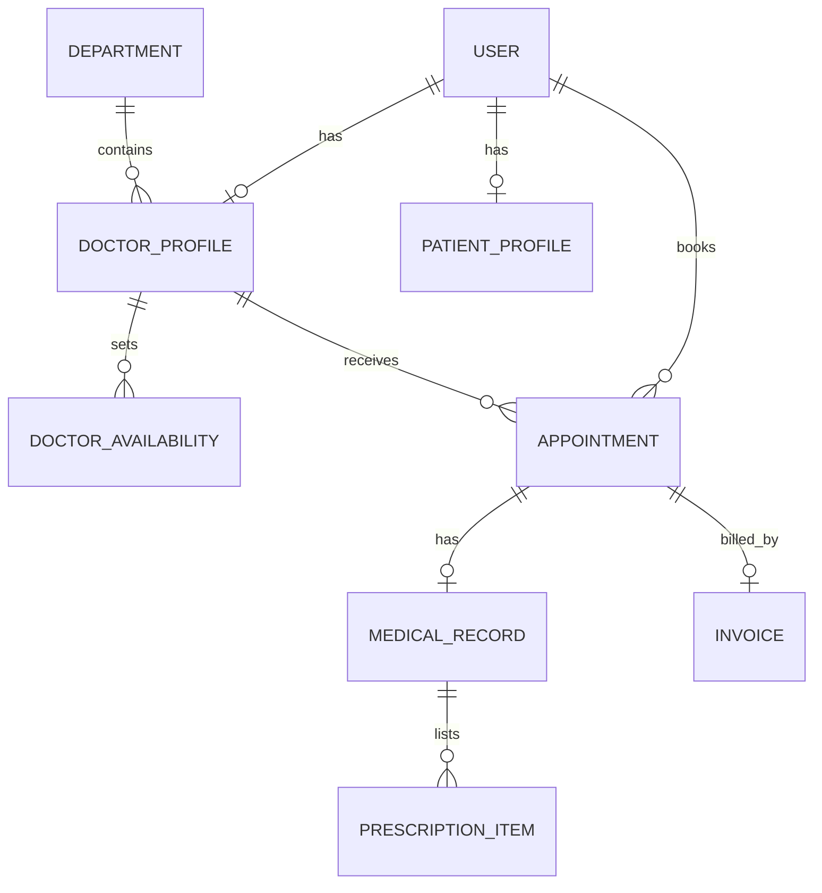
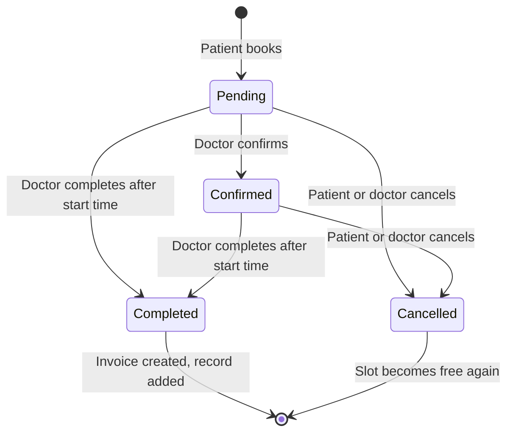

# 🏥 Hospital Management System

A full stack web application where patients book doctor appointments and doctors manage visits, medical records, prescriptions and billing. Built with **Django, MySQL, HTML, CSS and JavaScript**, with role-based access and a transaction-safe booking engine.




## Table of Contents

- [Features](#features)
- [Screenshots](#screenshots)
- [Tech Stack](#tech-stack)
- [System Requirements](#system-requirements)
- [Getting Started](#getting-started)
- [Demo Accounts](#demo-accounts)
- [User Flows](#user-flows)
- [Architecture](#architecture)
- [Database Design](#database-design)
- [Engineering Highlights](#engineering-highlights)
- [Project Structure](#project-structure)
- [Appointment Lifecycle](#appointment-lifecycle)
- [Limitations and Future Work](#limitations-and-future-work)

## Features

### 🧑 Patients
- Register, log in and log out securely
- Search doctors by name or specialization, and filter by department
- Pick a date and see **free slots load instantly** (JavaScript `fetch`, no page reload)
- Book and cancel appointments (cancellation closes 2 hours before the visit)
- View invoices, pay (simulated) and print them
- Read medical records and print prescriptions

### 🩺 Doctors
- Schedule with Today, Upcoming and History tabs
- Confirm, complete or cancel appointments
- Add notes, diagnosis and prescriptions
- View the history of patients they have treated
- Earnings page with collected and pending totals

### 🛠️ Admin
- Manage departments, doctors, patients, availability, appointments, invoices and records through the Django admin

### ⚙️ System
- Role-based access control with ownership checks
- Invoices created automatically and atomically when a visit is completed
- Responsive layout with a mobile menu
- Custom 403 and 404 pages
- Automated test suite

## Screenshots

### Authentication

| Login | Demo accounts |
|---|---|
|  |  |

### Dashboard and admin

| Dashboard | Admin panel |
|---|---|
|  |  |

## Tech Stack

| Layer | Technology | Purpose |
|---|---|---|
| Language | Python 3.12 | Backend logic |
| Framework | Django 5.2 | Routing, ORM, authentication, admin |
| Database | MySQL 8 | Relational storage with foreign keys |
| DB driver | mysqlclient | Connects Django to MySQL |
| Frontend | HTML5, CSS3 | Templates, responsive layout, print styles |
| Scripting | JavaScript (ES6) | Slot loading with `fetch`, mobile menu |
| Config | python-decouple | Secrets and settings from `.env` |
| Media | Pillow | Doctor photo uploads |
| Testing | Django TestCase | Automated tests |
| Tools | Git, GitHub, VS Code, MySQL Workbench | Version control, editing, database design |

## System Requirements

| Component | Version | Purpose |
|---|---|---|
| Python | 3.12 or higher | Runtime |
| MySQL Server | 8.0 or higher | Database |
| pip | Bundled with Python | Package manager |
| Git | Any | Version control |

## Getting Started

### 1. Clone and set up the environment

```
git clone https://github.com/tejaswini-n-cse/hospital-management-system.git
cd hospital-management-system
python -m venv venv
venv\Scripts\activate
pip install -r requirements.txt
```

### 2. Create the database

```sql
CREATE DATABASE hospital_db CHARACTER SET utf8mb4 COLLATE utf8mb4_unicode_ci;
```

### 3. Configure the environment

Copy `.env.example` to `.env` and fill in your values:

```
SECRET_KEY="your-generated-secret-key"
DEBUG=True
ALLOWED_HOSTS=127.0.0.1,localhost
DB_NAME=hospital_db
DB_USER=root
DB_PASSWORD="your-mysql-password"
DB_HOST=localhost
DB_PORT=3306
```

Generate a secret key:

```
python -c "from django.core.management.utils import get_random_secret_key; print(get_random_secret_key())"
```

### 4. Migrate, load demo data and run

```
python manage.py migrate
python manage.py createsuperuser
python manage.py seed_demo
python manage.py runserver
```

Open http://127.0.0.1:8000/

### 5. Run the tests

```
python manage.py test
```

## Demo Accounts

`seed_demo` creates these accounts. The password for all of them is `Demo@12345`.

| Role | Username | Notes |
|---|---|---|
| Doctor | `dr.sharma` | Cardiology, with a completed visit and a record |
| Doctor | `dr.rao` | Dermatology, with a paid invoice |
| Doctor | `dr.nair` | Pediatrics |
| Doctor | `dr.khan` | Cardiology |
| Patient | `patient.asha` | Completed visit, unpaid invoice, upcoming booking |
| Patient | `patient.ravi` | Pending appointment |
| Patient | `patient.sana` | Cancelled appointment |
| Admin | your superuser | Created with `createsuperuser`, at `/admin/` |

For local development only. The command refuses to run when `DEBUG=False`.

## User Flows

### Patient
```
1. Register, or log in as patient.asha
2. Open Doctors, then search or filter by department
3. Click View profile, then Book appointment
4. Pick a date, choose a slot and confirm
5. Track it under My appointments, and cancel if needed
6. After the visit: view the invoice and pay, then open the prescription
```

### Doctor
```
1. Log in as dr.sharma
2. Open My schedule (Today, Upcoming, History)
3. Confirm a pending appointment
4. After the visit time: Mark completed (an invoice is created automatically)
5. Add a record: diagnosis, notes and medicines
6. Check Earnings
```

### Admin
```
1. Open /admin/ with the superuser account
2. Add departments, doctors and their weekly availability
3. Monitor appointments, invoices and records
```

## Architecture



### Apps

| App | Responsibility |
|---|---|
| `accounts` | Custom user model, roles, registration, login, dashboards, `seed_demo` command |
| `appointments` | Doctor list, slot generation, booking, schedule, medical records |
| `billing` | Invoices, payments, doctor earnings |
| `config` | Settings and root URLs |

## Database Design



The same design as a diagram that GitHub renders:



| Table | Key fields | Relationships |
|---|---|---|
| `accounts_user` | username, role, phone | Custom user with a role |
| `accounts_department` | name, description | Has many doctors |
| `accounts_doctorprofile` | specialization, fee, experience | One to one with user, many to one with department |
| `accounts_patientprofile` | date of birth, gender, blood group | One to one with user |
| `appointments_doctoravailability` | day, start, end, slot minutes | Many per doctor |
| `appointments_appointment` | date, time, status, notes | Links a patient and a doctor |
| `appointments_medicalrecord` | diagnosis, follow-up date | One to one with appointment |
| `appointments_prescriptionitem` | medicine, dosage, frequency | Many per record |
| `billing_invoice` | fee, tax, total, status | One to one with appointment |

## Appointment Lifecycle



## Engineering Highlights

| Concern | How it is handled |
|---|---|
| **Double booking** | The booking runs in a transaction that locks the doctor's row with `select_for_update()`, then re-checks the slot, so two simultaneous requests cannot take the same time |
| **Authorization** | A `role_required` decorator plus ownership checks: patients see only their own invoices and records, doctors see only patients they have treated |
| **Billing integrity** | The invoice is created in the same transaction as the status change, money uses `Decimal`, and a `OneToOneField` guarantees one invoice per visit |
| **Idempotent payment** | The pay action updates only rows that are still unpaid, so double clicks cannot pay twice |
| **Secrets** | Kept in `.env`, never committed. `.env.example` documents the settings |
| **Safe redirects** | The `next` parameter is validated with `url_has_allowed_host_and_scheme` |
| **State changes** | POST only, with CSRF protection |
| **Performance** | `select_related` and `prefetch_related` avoid N+1 queries |

## Project Structure

```
hospital-management-system/
├── accounts/        users, roles, registration, dashboards, seed_demo command
├── appointments/    doctors, slots, booking, schedule, records, tests
├── billing/         invoices and payments
├── config/          settings and root URLs
├── templates/       HTML templates
├── static/          CSS and JavaScript
├── docs/            screenshots and ER diagram
├── manage.py
├── requirements.txt
└── .env.example
```

## Limitations and Future Work

- Payments are **simulated**. No real money is processed.
- No email or SMS notifications yet.
- Not deployed yet.

Planned improvements:

| Idea | Benefit |
|---|---|
| Razorpay or Stripe test-mode payments | Real payment flow |
| Email reminders | Fewer missed appointments |
| REST API with Django REST Framework | Mobile or React front end |
| Live deployment | A public demo link |

## Author

**Tejaswini N**
GitHub: https://github.com/tejaswini-n-cse