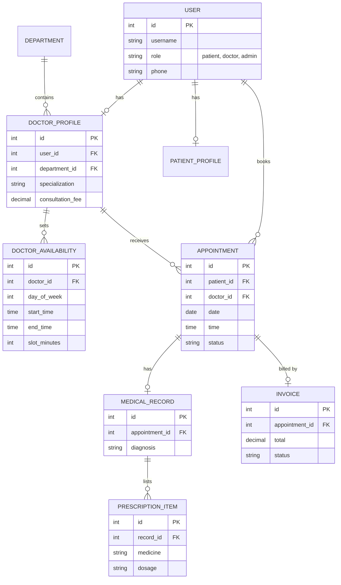

# 🏥 Hospital Management System

A full stack web app where patients book doctor appointments and doctors manage visits, medical records, and billing. Built with **Django, MySQL, HTML, CSS, and JavaScript**.


## Features

**Patients**
- Register, log in, and browse doctors with search and department filter
- Pick a date and see free time slots load instantly (JavaScript `fetch`, no page reload)
- Book, view, and cancel appointments (cancellation closes 2 hours before the visit)
- View invoices and pay (simulated), and print invoices
- See medical records and printable prescriptions

**Doctors**
- Schedule with Today, Upcoming, and History tabs
- Confirm, complete, or cancel appointments
- Add notes, diagnoses, and prescriptions after a visit
- View the history of patients they have treated
- Earnings page with paid and pending totals

**Admin**
- Django admin for departments, doctors, patients, availability, appointments, invoices, and records

## Engineering highlights

- **Double-booking prevention:** the booking runs inside a database transaction that locks the doctor's row with `select_for_update()`, then re-checks the slot, so two simultaneous requests cannot take the same time.
- **Role-based access control:** a `role_required` decorator, plus ownership checks (a patient sees only their own invoices and records; a doctor sees only patients they have treated).
- **Billing:** the invoice is created in the same transaction as the status change, uses `Decimal` for money, and is guaranteed unique per appointment (`OneToOneField`).
- **Security basics:** CSRF protection, POST-only state changes, secrets in `.env`, safe redirects, and custom 403 and 404 pages.
- **Automated tests** for slot generation, booking, cancellation, permissions, and billing.

## Screenshots

| Doctors | Booking |
|---|---|
|  |  |

| Patient dashboard | Doctor schedule |
|---|---|
|  |  |


## Database design



## Tech stack

Python 3.12, Django 5.2, MySQL 8, HTML5, CSS3, JavaScript (ES6)

## Run locally

```
git clone https://github.com/tejaswini-n-cse/hospital-management-system.git
cd hospital-management-system
python -m venv venv
venv\Scripts\activate
pip install -r requirements.txt
```

1. Create the database in MySQL: `CREATE DATABASE hospital_db CHARACTER SET utf8mb4 COLLATE utf8mb4_unicode_ci;`
2. Copy `.env.example` to `.env` and fill in the secret key and your MySQL password.
3. Run:

```
python manage.py migrate
python manage.py createsuperuser
python manage.py seed_demo
python manage.py runserver
```

Open http://127.0.0.1:8000/

## Demo accounts

`seed_demo` creates these accounts. The password for all of them is `Demo@12345`.

| Role | Username |
|---|---|
| Doctor | `dr.sharma`, `dr.rao`, `dr.nair`, `dr.khan` |
| Patient | `patient.asha`, `patient.ravi`, `patient.sana` |

These are for local development only. The command refuses to run when `DEBUG=False`.

## Run the tests

```
python manage.py test
```

## Project structure

```
accounts/       users, roles, registration, dashboards
appointments/   doctors list, slots, booking, schedule, records
billing/        invoices and payments
templates/      HTML templates
static/         CSS and JavaScript
```

## Limitations

- Payments are **simulated**. No real money is processed.
- No email or SMS notifications yet.
- Not deployed yet.

## Future improvements

- Real payment gateway (Razorpay or Stripe test mode)
- Email reminders for appointments
- REST API with Django REST Framework
- Deployment with a managed MySQL database

## Author

**Your Name**
GitHub: https://github.com/tejaswini-n-cse